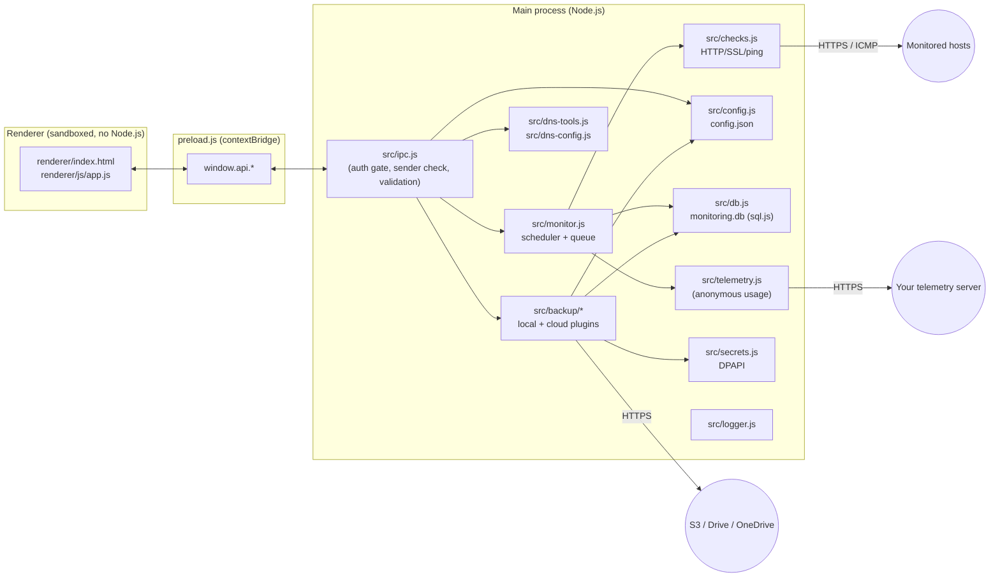

# DevoWatch

**DevoWatch** is a portable Windows desktop app for monitoring websites, IP addresses, SSL
certificates and DNS records, with a live dashboard, automatic local backups and optional cloud
backup/sync to Amazon S3, Google Drive or OneDrive.

Website: <https://devolity.com>

---

## Contents

1. [Features](#1-features)
2. [Quick start (development)](#2-quick-start-development)
3. [Building the standalone .exe](#3-building-the-standalone-exe)
4. [Architecture](#4-architecture)
5. [Data, files and formats](#5-data-files-and-formats)
6. [Module reference](#6-module-reference)
7. [IPC API (renderer to main)](#7-ipc-api-renderer-to-main)
8. [Backup & Sync](#8-backup--sync)
9. [Telemetry and the collection server](#9-telemetry-and-the-collection-server)
10. [Security model](#10-security-model)
11. [Reliability](#11-reliability)
12. [Extending DevoWatch](#12-extending-devowatch)
13. [Testing](#13-testing)
14. [Troubleshooting](#14-troubleshooting)
15. [Branding](#15-branding)

---

## 1. Features

| Area | What it does |
|---|---|
| **Dashboard** | One row per host: status (Up / Down / Partial / Paused / live "Checking..."), host + URL, IP (auto-resolved or manual), HTTP status + latency, ping + latency, TCP port chips (green open / red closed), SSL days left, last/next check. Search, status filter, summary cards. |
| **Checks** | HTTP(S) status and latency, TLS certificate expiry, ICMP ping, TCP ports. Per-host interval (1-1440 min). Bounded queue (8 concurrent), per-check watchdog. |
| **Ping fallback** | Many servers block ICMP. If ping gets no reply, DevoWatch tries a TCP connection to the host's **Ping fallback port** (or 443, then 80). A successful handshake counts as a reply and the Ping column shows e.g. `TCP 443`. |
| **Port monitoring** | Any TCP ports per host (up to 32): numbers (`443`, `8080`), service names (`ssh`, `ftp`, `rdp`, `smtp`, `mysql`, ...), or custom labels (`9000:minio`). Quick-add presets in the host form. Checked against the IP, or the URL's hostname if there is no IP. Records connect latency and, for greeting protocols (FTP, SSH, Telnet, SMTP, POP3, IMAP, VNC), the server banner (e.g. `SSH-2.0-OpenSSH_9.6`). No data is ever sent to the port. |
| **Auto IP** | Hosts with only a URL get their IPv4 resolved and pinged; the IP is refreshed on every check. |
| **DNS tools** | A, AAAA, CNAME, MX, TXT, CAA, NS, SOA, DMARC and PTR lookups via system, global, Google, Cloudflare or Quad9 resolvers; OS resolver + `hosts` file view; raw `dig`/`host`/`nslookup` output. |
| **Global DNS** | Optional resolvers (Settings) used for checks and IP resolution, with fallback to the system resolver. |
| **Import / export** | Hosts from JSON, CSV or a plain list (one URL/IP per line); export hosts (JSON/CSV) and check history (CSV). |
| **Progress** | Live check progress in the title bar, the sidebar and per row; import progress. |
| **Backup & Sync** | Automatic configuration backups to `<root>/backup`; full backups (config + history) locally or to S3 / Google Drive / OneDrive, scheduled with retention; optional AES-256 encryption; restore from any backup. |
| **Telemetry** | Anonymous usage counters sent to Grafana Cloud (on by default; users can switch it off, administrators can force it off). |
| **UI** | Custom title bar with native Windows controls, dark/light themes, sidebar navigation. |
| **Security** | Local accounts (bcrypt, lockout), sandboxed renderer, strict CSP, Electron fuses, DPAPI-encrypted credentials. |

---

## 2. Quick start (development)

### Prerequisites

- Windows 10/11 x64
- **Node.js 20+** (tested with 24 LTS) and npm 10+

### Install and run

```powershell
git clone <your-repo-url> devowatch
cd devowatch
npm install
npm install-scripts approve electron   # npm 11+: allow Electron's postinstall to download its runtime
npm rebuild electron                   # fetches node_modules/electron/dist/electron.exe if it was skipped
npm start
```

`npm install` also runs `scripts/copy-assets.js`, which copies Chart.js into `renderer/js/`.

On first launch, create the administrator account. In development, data is stored in
`./data` and backups in `./backup` (both git-ignored).

To produce the standalone `DevoWatch-Portable.exe`, run `npm run dist:portable`. See
[section 3](#3-building-the-standalone-exe) for the full step-by-step guide.

### npm scripts

| Script | Purpose |
|---|---|
| `npm start` | Run the app from source |
| `npm run icon` | Regenerate `renderer/img/icon.png` from `renderer/img/logo.png` (after changing the logo) |
| `npm run dist:portable` | Build `dist/DevoWatch-Portable.exe` (single self-extracting exe) |
| `npm run dist:zip` | Build `dist/DevoWatch-<version>-win-x64.zip` (unpacked folder, no %TEMP% extraction) |
| `npm run dist` | Build all targets configured in `package.json > build` |

---

## 3. Building the standalone .exe

DevoWatch ships as a **standalone Windows executable**: one `.exe` with no installer and no
admin rights. It doesn't need Node.js or anything else on the target PC. Copy it anywhere and
double-click it.

### 3.1 Build the standalone `.exe` (step by step)

Run these in **PowerShell** or **Command Prompt** on a Windows 10/11 x64 machine.

**1. Install the build tools (once)**

- Node.js 20 or newer (LTS recommended): <https://nodejs.org>, or `winget install OpenJS.NodeJS.LTS`, or `scoop install nodejs-lts`.
- Check: `node -v` (v20+) and `npm -v`.

**2. Get the source and install dependencies**

```powershell
cd C:\path\to\devowatch
npm install
```

**3. Make sure the Electron runtime was downloaded (npm 11+ only)**

npm 11 blocks dependency install scripts until approved, which stops Electron from downloading
its runtime. Check:

```powershell
Test-Path node_modules\electron\dist\electron.exe     # must print True
```

If it prints `False`:

```powershell
npm install-scripts approve electron
npm rebuild electron
```

**4. (Optional) Smoke-test from source**

```powershell
npm start
```

**5. Build the standalone exe**

```powershell
npm run dist:portable
```

This takes about 3-5 minutes. The first build is slower because electron-builder downloads its
tools into `%LOCALAPPDATA%\electron-builder\Cache`. Output:

```
dist\
  DevoWatch-Portable.exe     <-- the standalone app (about 105 MB), ship this file
  win-unpacked\              unpacked app folder (used to build the exe; also runnable)
```

**6. Verify the build (recommended before distributing)**

```powershell
# Version info baked into the exe
(Get-Item dist\DevoWatch-Portable.exe).VersionInfo | Select ProductName, CompanyName, FileVersion, LegalCopyright

# SHA-256 hash (publish it, or give it to IT for allow-listing)
Get-FileHash dist\DevoWatch-Portable.exe -Algorithm SHA256

# Antivirus scan with Microsoft Defender (report only)
& "$env:ProgramFiles\Windows Defender\MpCmdRun.exe" -Scan -ScanType 3 -File "$PWD\dist\DevoWatch-Portable.exe" -DisableRemediation
```

**7. Run / distribute**

- Copy `DevoWatch-Portable.exe` into any folder the user can write to (e.g. `D:\Tools\DevoWatch\`)
  and double-click it.
- On first run it creates `data\` and `backup\` **next to the exe**. To move the installation,
  move the whole folder, exe included.
- The first launch of a new build can take about 15 s while antivirus scans it; later launches
  are faster.
- To upgrade, replace the exe and keep the `data\` and `backup\` folders.

### 3.2 Build options

| Command | Output | Use when |
|---|---|---|
| `npm run dist:portable` | `dist\DevoWatch-Portable.exe` | Default: a single standalone exe |
| `npm run dist:zip` | `dist\DevoWatch-<version>-win-x64.zip` | Company policy blocks programs that self-extract to `%TEMP%` (AppLocker/WDAC). Unzip and run `DevoWatch.exe`. |
| `npx electron-builder --win portable zip` | both | Release builds |

How the standalone exe works: it's an electron-builder *portable* target. At each launch it
extracts the app to `%TEMP%` and runs it from there, while data stays next to the original exe
(`PORTABLE_EXECUTABLE_DIR`).

### 3.3 Before you release

1. **Bump the version** in `package.json` (`"version": "1.1.0"`). It's shown in **Settings >
   About** and in the exe's file properties.
2. Run `npm audit` and fix anything reported.
3. Build, verify (step 6 above), and publish the SHA-256 hash with the file.

### 3.4 Code signing (recommended for company laptops)

Builds are **unsigned** by default, so Windows SmartScreen may show "Windows protected your PC"
(choose *More info > Run anyway*), and managed devices may block the exe. To avoid that, sign
it with a code-signing certificate (an EV certificate gets SmartScreen reputation fastest):

```powershell
$env:CSC_LINK = "C:\secure\devowatch-codesign.pfx"   # or a base64 / https URL to the .pfx
$env:CSC_KEY_PASSWORD = "<pfx password>"
npm run dist:portable
Get-AuthenticodeSignature dist\DevoWatch-Portable.exe   # Status must be "Valid"
```

Never commit the `.pfx` or its password (`.gitignore` already excludes `*.pfx`, `*.p12` and
`.env`). If you can't sign, ask IT to allow-list the exe's SHA-256 hash.

### 3.5 Build configuration reference

- **Product metadata**: `package.json`: `productName`, `version`, `build.appId`,
  `build.copyright`, and the output name under `build.portable.artifactName`.
- **Icon**: `renderer/img/icon.png` (512x512, round badge, transparent corners; converted to `.ico`
  automatically). It's generated from the source artwork `renderer/img/logo.png`. After replacing
  the logo, run `npm run icon`, then rebuild. `scripts/make-icon.ps1` modes:
  - default (`-Mode symbol`): keeps only the logo's main colour (the symbol). Text and captions in
    other colours are dropped, and the symbol is centred on a round badge in the logo's
    background colour.
  - `-Mode crop`: for artwork that is already a round image; crops it and masks it to a circle.
  - `-Badge none`: the symbol on a transparent background.
  - `-Padding 0.1`: more space around the symbol.

  Run directly, e.g. `powershell -File scripts\make-icon.ps1 -Mode crop`.
- **Electron fuses** (`package.json > build.electronFuses`): `RunAsNode`, `NODE_OPTIONS` and
  `--inspect` are disabled, and ASAR integrity validation and `OnlyLoadAppFromAsar` are enabled.
  The packaged exe can't be repurposed as a general Node.js runtime.
- **Included files**: `package.json > build.files`. The `server/` folder, tests and runtime
  data are not shipped.

### 3.6 Build troubleshooting

| Problem | Fix |
|---|---|
| `electron.exe` missing / `Electron failed to install correctly` | Step 3: `npm install-scripts approve electron` then `npm rebuild electron` |
| `Cannot create symbolic link : A required privilege is not held by the client` (winCodeSign) | Turn on **Settings > System > For developers > Developer Mode** and rebuild, or run the terminal as Administrator once so the cache is extracted |
| `spawn powershell.exe ENOENT` | You're building from Git Bash/MSYS2: add `C:\Windows\System32\WindowsPowerShell\v1.0` to `PATH`, or build from PowerShell |
| `EBUSY` / `resource busy or locked` on `dist\DevoWatch-Portable.exe` | Close any running DevoWatch, wait for antivirus to finish scanning, then rebuild |
| Very slow first build | electron-builder downloads Electron and NSIS tools once; later builds reuse the cache |

---

## 4. Architecture

DevoWatch is an Electron app with a strict split between the privileged **main process**
(Node.js: files, network, child processes) and an unprivileged, sandboxed **renderer** (the UI).
They talk only through a small whitelisted IPC API exposed by `preload.js`.



### Startup sequence (`main.js`)

1. Single-instance lock (a second copy exits and focuses the first).
2. Global error handlers, web-contents hardening (no navigation, pop-ups or webviews).
3. `app.whenReady`: init logger, deny all permission requests, remove the app menu.
4. Load `config.json` (with backup recovery), open `monitoring.db` (with corruption recovery).
5. Register IPC handlers, init the **backup manager** (startup snapshot, save hook, cloud
   scheduler) and **telemetry** (if enabled).
6. Create the window (custom title bar + native control overlay), then load `renderer/index.html`.
7. After the user signs in, `monitor.startAll()` schedules every enabled host.
8. On quit: stop the monitor, flush pending backups/telemetry, flush the database.

### Monitoring pipeline

```
setInterval per host --> enqueue(hostId) --> queue --> pump (max 8 running)
   --> runHostChecks: [dns] resolveHostIp --> [http] checkHttp --> [ping] checkPing (TCP fallback) --> [ports] checkTcp (parallel)
   --> db.insertCheck --> broadcast 'monitor:result' --> renderer updates the row
   (activity snapshots 'monitor:activity' drive the progress UI; 90 s watchdog per job)
```

---

## 5. Data, files and formats

`<root>` is the folder containing the exe (portable) or the project folder (development). If it
isn't writable, DevoWatch falls back to `%APPDATA%\DevoWatch`.

```
<root>/
  DevoWatch-Portable.exe        (or DevoWatch.exe from the ZIP)
  policy.json                   optional, administrator policy (see section 9)
  data/
    config.json                 settings, hosts, users (bcrypt hashes)
    config.json.bak             last known-good config (auto)
    monitoring.db               SQLite check history (sql.js)
    secrets.json                DPAPI-encrypted credentials (cloud keys/tokens, passphrase)
    telemetry-queue.json        pending telemetry events (only when enabled)
    logs/devowatch.log          rotating log (2 MB x 3)
  backup/
    devowatch-config-YYYYMMDD-HHMMSS.json        automatic config snapshots
    devowatch-backup-YYYYMMDD-HHMMSS.json.gz     manual full backups (.enc when encrypted)
```

### `config.json`

```jsonc
{
  "settings": {
    "retentionDays": 7, "defaultIntervalMinutes": 5, "sslWarnDays": 30, "sslCriticalDays": 7,
    "dnsServers": ["1.1.1.1"],
    "backup": { "localEnabled": true, "localKeep": 30, "cloudProvider": "s3", "cloudEnabled": true,
                "cloudIntervalHours": 24, "cloudKeep": 14, "includeHistory": true,
                "providers": { "s3": { "bucket": "...", "region": "...", "prefix": "devowatch/", "accessKeyId": "..." } } },
    "telemetry": { "enabled": false, "installId": null }
  },
  "hosts": [{ "id": "uuid", "name": "GitHub", "url": "https://github.com/", "ip": "20.207.73.82",
              "ipAuto": true, "intervalMinutes": 5, "enabled": true, "createdAt": "...",
              "ports": [{ "port": 443, "service": "https" }, { "port": 22, "service": "ssh" },
                        { "port": 9000, "service": "minio", "custom": true }],
              "pingPort": null }],
  "users": [{ "username": "admin", "passwordHash": "$2a$10$...", "createdAt": "..." }]
}
```

Secrets (S3 secret key, OAuth client secret/refresh tokens, backup passphrase) are **never**
stored in `config.json` or exports. They live in `secrets.json`, encrypted with Windows DPAPI
for the current Windows user. Copying the data folder to another PC or user does not carry them;
restoring a **passphrase-encrypted full backup** does (the passphrase itself is never included).

### `monitoring.db`: table `checks`

| Column | Type | Notes |
|---|---|---|
| `id` | INTEGER PK | |
| `host_id`, `host_name`, `target` | TEXT | |
| `check_type` | TEXT | `http`, `https`, `ping`, `tcp` |
| `timestamp` | INTEGER | epoch ms (indexed) |
| `is_up` | INTEGER | 0/1 (for `tcp`: port open) |
| `latency_ms`, `http_status`, `resolved_ip` | | |
| `ssl_valid`, `ssl_issuer`, `ssl_valid_from`, `ssl_valid_to`, `ssl_days_remaining` | | https only |
| `port` | INTEGER | tcp only |
| `detail` | TEXT | tcp: service banner, if any. ping: `TCP 443` when the host was reached via the TCP fallback |
| `error` | TEXT | |

Rows older than `retentionDays` are pruned every 6 hours (followed by `VACUUM`). Databases
created by older versions are upgraded in place on startup and on restore (`port`/`detail` columns added).

### Import / export columns

CSV header (any order, case-insensitive): `name,url,ip,ports,pingPort,intervalMinutes,enabled`. In CSV
and JSON exports `ports` is a `;`-separated list, e.g. `443;22;9000:minio`. On import, ports
may be separated by `;`, `,` or spaces (quote the cell if it contains commas).

### Backup file format (`src/backup/bundle.js`)

- **Config snapshot**: plain JSON envelope (`*.json`).
- **Full backup**: `gzip(JSON envelope)` (`*.json.gz`).
- **Encrypted full backup**: `"DWENC1" | salt(16) | iv(12) | tag(16) | AES-256-GCM(gzip(envelope))` (`*.json.gz.enc`).
  The key is derived with scrypt (N=2^15, r=8, p=1).

```json
{ "app": "DevoWatch", "format": 1, "kind": "config|full", "createdAt": "...", "appVersion": "1.0.0",
  "config": { "settings": {}, "hosts": [], "users": [] }, "db": "<base64 SQLite, full backups only>" }
```

---

## 6. Module reference

| File | Responsibility |
|---|---|
| `main.js` | App lifecycle, single instance, hardening, window (title bar overlay), crash recovery, shutdown |
| `preload.js` | `window.api` bridge: the only surface the UI can call |
| `src/ipc.js` | All IPC handlers; sender verification, auth gate, input validation, logging |
| `src/paths.js` | `<root>`, `data/`, `backup/` resolution with read-only fallback |
| `src/config.js` | JSON store (atomic writes, `.bak` recovery, save hooks, snapshot/replace) |
| `src/db.js` | sql.js database, batched atomic flushes, corruption quarantine, export/replace |
| `src/fsutil.js` | `writeFileAtomic`, `quarantine` |
| `src/logger.js` | Rotating file logger |
| `src/auth.js` | bcrypt login, lockout, password change |
| `src/checks.js` | `checkHttp` (hard deadline, TLS info), `checkPing` (argument validation), `checkTcp` (connect + passive banner read), `resolveHostIp` |
| `src/ports.js` | Known service names, port list parsing/validation and formatting |
| `src/monitor.js` | Scheduler, bounded queue, watchdog, activity/progress broadcasts |
| `src/dns-config.js` | Global DNS servers, drop-in `lookup()` with system fallback |
| `src/dns-tools.js` | DNS record lookups, hosts file, raw `dig`/`host`/`nslookup` |
| `src/transfer.js` | Import parsing/validation (JSON/CSV/TXT), CSV-injection-safe export, host input validation |
| `src/secrets.js` | DPAPI-encrypted credential store |
| `src/backup/index.js` | Backup manager: local auto backup, full backups, cloud schedule, retention, restore |
| `src/backup/bundle.js` | Backup envelope, gzip, AES-256-GCM |
| `src/backup/oauth.js` | OAuth 2.0 PKCE loopback sign-in (system browser) |
| `src/backup/oauth-clients.js` | Built-in Google / Microsoft OAuth app IDs (sign-in-only mode) |
| `src/backup/http.js` | fetch wrapper (timeouts, readable errors) |
| `src/backup/providers/*.js` | Cloud plugins: `s3.js` (SigV4), `gdrive.js`, `onedrive.js` |
| `src/telemetry.js` | Anonymous usage telemetry (queue, HTTPS upload, Faro format, policy) |
| `renderer/index.html` | Markup, SVG icon sprite, CSP |
| `renderer/css/style.css` | Design tokens (HSL, dark/light) and components |
| `renderer/js/app.js` | UI logic (pages, live updates, modals, backup/telemetry UI) |
| `renderer/js/theme.js` | Applies the saved theme before first paint |
| `server/telemetry-collector/` | Reference telemetry collection server (Node, no deps) + Dockerfile |

---

## 7. IPC API (renderer to main)

Every channel is registered through `handle()` in `src/ipc.js`. It rejects calls that don't come
from `renderer/index.html` and logs failures. All channels except `auth:*`, `app:info`,
`app:openExternal`, `app:setTitleBarTheme` and `log:renderer` require a signed-in user.

| Group | Channels |
|---|---|
| Auth | `auth:needsSetup`, `auth:createFirstUser`, `auth:login`, `auth:logout`, `auth:currentUser`, `auth:changePassword` |
| Hosts | `hosts:list`, `hosts:add`, `hosts:update`, `hosts:delete`, `hosts:checkNow` |
| Settings | `settings:get`, `settings:update` |
| Data | `data:latestPerHost`, `data:recentChecks`, `data:history`, `data:uptimeSummary` |
| Monitoring | `monitor:activity`, `monitor:checkAll` |
| DNS | `dns:servers`, `dns:lookup` |
| Import/export | `transfer:export` (`hosts-json`, `hosts-csv`, `history-csv`), `transfer:import` |
| Backup | `backup:status`, `backup:updateSettings`, `backup:setProvider`, `backup:connect`, `backup:disconnect`, `backup:test`, `backup:setPassphrase`, `backup:runLocal`, `backup:runCloud`, `backup:listCloud`, `backup:restore`, `backup:openFolder` |
| Telemetry | `telemetry:status`, `telemetry:update`, `telemetry:preview`, `telemetry:sendNow` |
| App | `app:info`, `app:openExternal` (devolity.com only), `app:openDataFolder`, `app:setTitleBarTheme`, `log:renderer` |

Main-to-renderer push events: `monitor:result`, `monitor:activity`, `hosts:changed`,
`transfer:progress`, `backup:progress`, `backup:changed`.

---

## 8. Backup & Sync

### 8.1 Automatic local backup (on by default)

- After every **real** configuration change (hosts, settings, users), a snapshot
  `devowatch-config-<timestamp>.json` is written to `<root>/backup`. Changes are debounced by
  5 s. Identical content is skipped; bookkeeping fields and auto-resolved IP changes are ignored.
- A snapshot is also taken at startup (if changed), before every restore, and at shutdown if
  one is pending.
- The last **N** snapshots are kept (default 30, configurable). **Full backup now** adds a
  `devowatch-backup-*.json.gz` file (config + check history).

### 8.2 Cloud backup

Open **Backup & Sync** and pick a provider. For **Google Drive** and **OneDrive**, click
**Sign in with Google / Microsoft**, sign in in the browser and allow access - no keys or IDs to
enter (when the build contains the publisher's OAuth apps, see "One-time publisher setup" below).
For S3, fill in the fields and click **Save provider**. Then turn on **Automatic cloud backup**.
Options:
- **Interval**: 1-168 hours. A failed backup is retried after 1 hour.
- **Keep last N**: older cloud backups are deleted.
- **Include check history**: whether full backups contain `monitoring.db`.
- **Encryption passphrase**: if set, full backups are AES-256-GCM encrypted before upload. Keep
  the passphrase safe; encrypted backups can't be restored without it.

"Sync" works by snapshot: the latest state is uploaded on a schedule, and any machine
configured with the same provider (and passphrase) can **Restore** it.

What a backup contains:

| Item | Config snapshot (`devowatch-config-*.json`) | Full backup | Encrypted full backup |
|---|---|---|---|
| Hosts (URLs, IPs, ports, ping fallback, intervals) | yes | yes | yes |
| User accounts (bcrypt hashes) | yes | yes | yes |
| All settings: retention, intervals, SSL thresholds, global DNS, theme, backup schedule/provider, usage-data switch | yes | yes | yes |
| Check history (`monitoring.db`) | - | if "Include check history" | if "Include check history" |
| Cloud credentials (S3 keys, Google/Microsoft sign-in) | - | - | yes |

On restore, machine-specific bookkeeping stays from the restoring PC (last cloud-backup time,
telemetry install ID). The backup passphrase is never stored in a backup. Without credentials
in the backup, the provider settings are restored and you only need to sign in / re-enter keys.
Not included: `policy.json` (administrator file next to the exe) and logs.

#### Amazon S3 / S3-compatible

1. Create a bucket (for example `devowatch-backups`) and an IAM user or access key with this policy:

```json
{
  "Version": "2012-10-17",
  "Statement": [
    { "Effect": "Allow", "Action": ["s3:ListBucket"], "Resource": "arn:aws:s3:::devowatch-backups",
      "Condition": { "StringLike": { "s3:prefix": ["devowatch/*"] } } },
    { "Effect": "Allow", "Action": ["s3:PutObject", "s3:GetObject", "s3:DeleteObject"],
      "Resource": "arn:aws:s3:::devowatch-backups/devowatch/*" }
  ]
}
```

2. In DevoWatch, enter Bucket, Region, Key prefix (`devowatch/`), Access key ID and Secret access key.
3. For S3-compatible stores, also set **Custom endpoint**:
   - MinIO: `https://minio.example.com` with **Path-style** on.
   - Cloudflare R2: `https://<account>.r2.cloudflarestorage.com` with region `auto`.
   - Wasabi / Backblaze B2: their S3 endpoint URL.
   Plain `http://` is only allowed for `localhost`.

#### Google Drive and OneDrive: one-time publisher setup

Users only sign in. For that, the publisher (Devolity) registers **one** OAuth app per cloud and
puts the IDs in `src/backup/oauth-clients.js`, then rebuilds:

```js
module.exports = {
  google: { clientId: '1234-abc.apps.googleusercontent.com', clientSecret: 'GOCSPX-...' },
  microsoft: { clientId: '00000000-0000-0000-0000-000000000000' },
};
```

These values are safe to ship in the exe: desktop OAuth clients are public clients (RFC 8252,
protected by PKCE + loopback redirect), and Google documents that a "Desktop app" client secret
is not confidential. Users' refresh tokens are still stored DPAPI-encrypted on their own PC.
If a client ID is left empty, that provider falls back to asking the user for their own app
registration (the fields described below).

**Google** ([Google Cloud Console](https://console.cloud.google.com/)):
1. Create a project, enable the **Google Drive API**.
2. **OAuth consent screen**: user type **External**, app name `DevoWatch`, logo, home page
   `https://devolity.com`, privacy policy URL; add the scope `.../auth/drive.file` (non-sensitive).
3. **Publish the app** (Publishing status: *In production*). In *Testing* status only listed test
   users can sign in and refresh tokens expire after 7 days. Google may ask for brand verification
   (domain ownership of devolity.com) before the name/logo are shown.
4. **Credentials > Create credentials > OAuth client ID**, type **Desktop app**. Copy the client ID
   and client secret into `oauth-clients.js`.

**Microsoft** ([Entra ID > App registrations](https://portal.azure.com/#view/Microsoft_AAD_IAM/ActiveDirectoryMenuBlade/~/RegisteredApps)):
1. **New registration**, name `DevoWatch`, supported accounts **Accounts in any organizational
   directory and personal Microsoft accounts**.
2. Redirect URI: platform **Public client/native (mobile & desktop)**, URI `http://127.0.0.1`.
3. **Authentication**: *Allow public client flows* = **Yes**.
4. **API permissions**: Microsoft Graph delegated `Files.ReadWrite`, `User.Read`, `offline_access`.
5. Recommended: **Branding & properties > Publisher verification** (Microsoft Partner ID), so users
   don't see an "unverified" warning. Some companies require an admin to approve third-party apps;
   their admin can grant consent once for the whole tenant.
6. Copy the **Application (client) ID** into `oauth-clients.js` (no secret needed).

#### Google Drive (own app registration, only if no built-in app)

1. In [Google Cloud Console](https://console.cloud.google.com/), create a project and enable the
   **Google Drive API**.
2. Under **APIs & Services > OAuth consent screen**, configure it (Internal for Workspace orgs)
   and add the scope `.../auth/drive.file`.
3. Under **Credentials > Create credentials > OAuth client ID**, choose application type
   **Desktop app**. Copy the client ID and client secret.
4. In DevoWatch, enter both, click **Save provider**, then **Connect**. Your browser opens; sign in
   and allow access. DevoWatch can only see files it creates itself (`drive.file` scope).

#### Microsoft OneDrive (own app registration, only if no built-in app)

1. In [Entra ID (Azure portal) > App registrations](https://portal.azure.com/#view/Microsoft_AAD_IAM/ActiveDirectoryMenuBlade/~/RegisteredApps),
   create a **New registration**:
   - Supported accounts: as required (single tenant for company-only use).
   - Redirect URI: platform **Public client/native (mobile & desktop)**, URI `http://127.0.0.1`.
2. Under **Authentication**, set **Allow public client flows = Yes**.
3. Under **API permissions**, add the Microsoft Graph delegated permissions `Files.ReadWrite`,
   `User.Read` and `offline_access`. Grant admin consent if your tenant requires it.
4. In DevoWatch, enter the Application (client) ID and the Tenant (`common`, `organizations` or
   your tenant ID). Click **Save provider**, then **Connect**. Backups go to `Apps/DevoWatch` in
   OneDrive by default.

Sign-in uses the OAuth 2.0 authorization-code flow with **PKCE** through the system browser.
DevoWatch listens once on `127.0.0.1` on a random port and validates `state`. The refresh token
is stored DPAPI-encrypted; **Sign out** deletes it.

---

## 9. Telemetry and the collection server

### 9.1 What the app sends

Telemetry is **on by default**. The only user control is the on/off switch in
**Settings > Usage data**; turning it off is remembered, clears the queue and discards the install
ID. Administrators can force it off for all users with `policy.json` (9.2). The collection endpoint
is not user-editable: it is `DEFAULT_ENDPOINT` in `src/telemetry.js` (built into the exe), or
`telemetryEndpoint` in `policy.json`.

The built-in endpoint is **Grafana Cloud Frontend Observability (Faro)**:
`https://faro-collector-prod-ap-southeast-1.grafana.net/collect/527a72708b642cdc6b4dbda702678f92`.
Faro collector URLs are designed to be public (no secret). When the endpoint is a Faro collector,
the batch is converted to the Faro format (see 9.3); any other endpoint gets the generic JSON
below (for the self-hosted server in 9.4).

Upload schedule: first batch about **30 seconds** after start, then **every hour**, immediately
after the switch is turned on, and once more when the app closes (max 3 s, so quitting never
hangs). Failed uploads are retried with backoff (5 min doubling up to 24 h); the queue holds at
most 500 events.

Generic format:

```json
{
  "schema": 1,
  "installId": "random-uuid (not hardware-derived; discarded when telemetry is turned off)",
  "sentAt": "2026-10-01T05:14:32.039Z",
  "app": { "name": "DevoWatch", "version": "1.0.0", "electron": "44.5.1" },
  "os": { "platform": "win32", "release": "10.0.26100", "arch": "x64", "locale": "en-US" },
  "events": [
    { "name": "app_start", "ts": 1790000000000, "props": { "version": "1.0.0" } },
    { "name": "usage", "ts": 1790000000000, "props": {
        "period_hours": 6, "hosts": 12, "hosts_enabled": 11, "hosts_with_url": 10, "hosts_with_ip": 12,
        "hosts_with_ports": 4, "ports_monitored": 9, "global_dns": true, "cloud_backup": "s3",
        "check_https_ok": 830, "check_https_fail": 4, "check_ping_ok": 900, "check_tcp_ok": 640,
        "feature_dns_lookup": 3, "feature_import": 1, "feature_backup_cloud": 1 } }
  ]
}
```

**Never sent**: hostnames, URLs, IP addresses, usernames, error messages and file paths. This is
enforced in `sanitizeProps()`, both in the app and on the server: only numbers, booleans and two
allow-listed enums (`version`, `cloud_backup`) pass. To add a metric, call
`telemetry.count('feature_xyz')` in the main process.

### 9.2 Enterprise control: `policy.json`

Place `policy.json` next to the exe:

```json
{ "telemetry": false }
```

That forces telemetry off. The setting is locked in the UI and the change is logged. To force it
on and preset the endpoint for a managed fleet where consent is handled by company policy:

```json
{ "telemetry": true, "telemetryEndpoint": "https://telemetry.devolity.com/v1/events" }
```

The environment variable `DEVOWATCH_TELEMETRY=0` also forces it off. To change the built-in
endpoint, edit `DEFAULT_ENDPOINT` in `src/telemetry.js` and rebuild.

### 9.3 Grafana Cloud (built-in destination)

Each batch is sent as a Faro payload with the `X-Faro-Session-Id` header:

| Faro field | DevoWatch value |
|---|---|
| `meta.app` | `name: DevoWatch`, `version`, `environment` (`production` for the built exe, `development` for `npm start`) |
| `meta.user.id` | the anonymous install ID |
| `meta.session.id` | random, new on every app start |
| `meta.browser` | `Electron <version>`, OS `win32 <release> x64`, locale |
| `events[]` | `app_start`, `telemetry_enabled`, `usage` (domain `devowatch`; all props as string attributes) |
| `measurements[]` | `type: devowatch_usage` with every numeric usage counter (booleans as 0/1) |

Where to look in Grafana Cloud:

- **Frontend Observability > DevoWatch app**: sessions, events and measurements.
- **Explore > Loki** (the Faro data source), for example:
  - `{app_name="DevoWatch", kind="event"} | logfmt | event_name="usage"`
  - `sum by (app_version) (count_over_time({app_name="DevoWatch", kind="event"} | logfmt | event_name="app_start" [1d]))`
  - `{app_name="DevoWatch", kind="measurement"} | logfmt | type="devowatch_usage"` (fields `value_hosts`, `value_check_https_ok`, ...)
- Filter out test data with `app_environment="production"` (logfmt field). If the `app_name`
  label in your stack differs (Grafana may use the name you gave the app), use the label shown in
  Explore's label browser.

The free plan has monthly ingestion limits; one session is counted per app start that sends data.
To stop collection globally, remove or rotate the app key in Grafana (the app then logs
`Upload failed` and keeps retrying with backoff; queued events are capped at 500).

### 9.4 Self-hosted collection server (alternative)

The reference server is `server/telemetry-collector/server.js`: Node 18+, **no dependencies**.

- **Endpoints**:
  - `POST /v1/events` validates and sanitises the batch and appends one JSON line per event to
    `data/events-YYYY-MM-DD.ndjson`.
  - `GET /healthz` is a liveness check.
- **Limits**: 256 KB body, 500 events per batch, 120 requests/hour per client (rate-limited by an
  in-memory hash; IPs are never written to disk), 15 s timeouts.
- **Retention**: files older than `RETENTION_DAYS` (default 90) are deleted automatically.
- **Configuration** (environment variables): `PORT` (8787), `HOST` (127.0.0.1), `DATA_DIR`,
  `RETENTION_DAYS`, `RATE_LIMIT_PER_HOUR`, `TRUST_PROXY=1` (behind a proxy that sets
  `X-Forwarded-For`).

#### Option A: Linux VM + Caddy (automatic HTTPS)

```bash
# 1. DNS: point telemetry.devolity.com (A/AAAA) to the server.
# 2. App
sudo useradd --system --create-home --home-dir /opt/devowatch-telemetry devowatch
sudo cp server/telemetry-collector/server.js /opt/devowatch-telemetry/
# 3. systemd service: /etc/systemd/system/devowatch-telemetry.service
```

```ini
[Unit]
Description=DevoWatch telemetry collector
After=network.target

[Service]
User=devowatch
WorkingDirectory=/opt/devowatch-telemetry
Environment=PORT=8787 HOST=127.0.0.1 DATA_DIR=/opt/devowatch-telemetry/data TRUST_PROXY=1
ExecStart=/usr/bin/node server.js
Restart=always
NoNewPrivileges=true
ProtectSystem=strict
ReadWritePaths=/opt/devowatch-telemetry/data

[Install]
WantedBy=multi-user.target
```

```bash
sudo mkdir -p /opt/devowatch-telemetry/data && sudo chown devowatch /opt/devowatch-telemetry/data
sudo systemctl enable --now devowatch-telemetry
# 4. Caddy (/etc/caddy/Caddyfile) - obtains and renews the TLS certificate automatically:
#    telemetry.devolity.com {
#        reverse_proxy 127.0.0.1:8787
#    }
sudo systemctl reload caddy
curl https://telemetry.devolity.com/healthz      # -> {"ok":true}
```

#### Option B: Docker

```bash
cd server/telemetry-collector
docker build -t devowatch-telemetry .
docker run -d --name devowatch-telemetry --restart unless-stopped \
  -p 127.0.0.1:8787:8787 -v devowatch-telemetry:/data devowatch-telemetry
# then put Caddy / nginx / a cloud load balancer with TLS in front of port 8787
```

nginx equivalent: `location /v1/events { proxy_pass http://127.0.0.1:8787; proxy_set_header X-Forwarded-For $remote_addr; client_max_body_size 256k; }`.

#### Point the app at it

Set `DEFAULT_ENDPOINT` in `src/telemetry.js` to `https://telemetry.devolity.com/v1/events` and
rebuild, or preset it per machine with `telemetryEndpoint` in `policy.json`.

#### Analysing the data

```bash
# events per day / active installs
cat data/events-*.ndjson | jq -r '.installId' | sort -u | wc -l
# version distribution
cat data/events-*.ndjson | jq -r 'select(.name=="app_start") | .app.version' | sort | uniq -c
# DuckDB: SELECT app.version, count(DISTINCT installId) FROM read_json_auto('data/*.ndjson') GROUP BY 1;
```

For dashboards, ship the NDJSON files to your log/analytics stack (Loki, Elastic, BigQuery, ...).

#### Legal

Publish a privacy notice describing the data above. If you force telemetry on through
`policy.json`, make sure your organisation has a legal basis for it (e.g. legitimate interest
for internal fleet management). The installation ID is pseudonymous, and there is no client IP
storage by design.

---

## 10. Security model

- **Renderer**:
  - `contextIsolation`, `sandbox`, `nodeIntegration: false`, `webviewTag: false`.
  - Strict CSP (`script-src 'self'`).
  - Navigation, `window.open`, webviews and all permission requests are blocked.
  - DevTools are disabled in packaged builds.
- **IPC**: only the bundled page may call it; there is an auth gate, and every input is
  validated (host fields, IDs, ranges, provider configs, endpoints).
- **Process execution**: `ping.exe`, `nslookup`/`dig`/`host` are spawned **without a shell**,
  with validated arguments (no leading `-`).
- **Network**: monitoring targets only, plus cloud backup (if configured) and anonymous telemetry over HTTPS.
  External links can only open `https://devolity.com`.
- **Credentials**: user passwords use bcrypt (cost 10), lockout after 5 failures (30 s doubling
  to 15 min), and the same message and timing for unknown users. Cloud secrets are
  DPAPI-encrypted and excluded from backups and exports.
- **Exports**: CSV cells are protected against formula injection.
- **Build**: Electron fuses (see section 3). Dependencies are kept to four runtime packages
  (`bcryptjs`, `chart.js`, `ping`, `sql.js`). Run `npm audit` before releases.

---

## 11. Reliability

- Atomic writes (temp file, fsync, rename with retry for AV locks) for config, DB, backups and secrets.
- `config.json` corruption: restore from `config.json.bak`, and never silently reset (which would wipe users).
- `monitoring.db` corruption: quarantined (`*.corrupt-<time>`) and recreated.
- DB writes are batched (at most 2 s delay) and flushed on exit.
- Bounded check queue, 90 s watchdog per job, overall HTTP deadline, ping timeout.
- Renderer auto-reloads after a crash; checks refresh after sleep/resume; single instance per data folder.
- Logs: `data/logs/devowatch.log` (2 MB x 3). Renderer errors are forwarded to the log.

---

## 12. Extending DevoWatch

### Add a cloud backup provider (e.g. Dropbox, Azure Blob, SFTP)

1. Create `src/backup/providers/<id>.js` implementing the interface documented in
   `src/backup/providers/index.js`:
   - `id`, `label`, `description`, `oauth`, `fields[]`
   - `validate()`, `connect?()`, `test()`, `upload()`, `list()`, `download()`, `remove()`

   Mark credential fields with `secret: true`. The manager stores them DPAPI-encrypted and
   passes them through `ctx.getSecret()`. For OAuth providers, use `authorize()` from
   `../oauth` and save the refresh token with `ctx.setSecret('refreshToken', ...)`.
2. Add it to the `PROVIDERS` array in `providers/index.js`.

The UI renders the provider's form from `fields` automatically; no renderer changes are needed.

### Add a new check type (e.g. keyword match)

The TCP port check (`checkTcp` + `src/ports.js`) is a complete worked example of these steps.

1. Implement the probe in `src/checks.js` (always with a timeout, validated input, no shell).
2. Call it from `runHostChecks()` in `src/monitor.js` with a new `check_type`, using
   `setStage()` for progress, `db.insertCheck()` and the broadcast.
3. Add any new host fields to `transfer.validateHostInput()` (and import/export if needed), plus
   the host form in `renderer/index.html` / `app.js`.
4. Render the result in `renderDashboard()` (`checkCell()` / `portChips()` helpers).

### Add a known service name for ports

Add it to `SERVICES` in `src/ports.js` (e.g. `kafka: 9092`). If the protocol greets the client
first (server speaks first, plain text), also add the port to `BANNER_PORTS` so its banner is recorded.
To show it as a quick-add chip, add a `<button class="chip" data-port="..." data-name="...">`
to `#port-presets` in `renderer/index.html`.

### Add a setting

1. Default value in `DEFAULT_CONFIG.settings` (`src/config.js`).
2. Validation in `validateSettings()` (`src/ipc.js`).
3. UI field in `renderer/index.html` and `fillSettingsForm()` / `wireSettings()` in `app.js`.

### Add an IPC call

1. `handle('area:action', ...)` in `src/ipc.js`: call `requireAuth()` and validate the input.
2. Expose it in `preload.js` (`window.api.xyz`).
3. Use it from `renderer/js/app.js`.

### Add a page

1. Add a `<button class="nav-item" data-tab="x">` and `<section id="tab-x" class="tab-panel">` in `index.html`.
2. Add `x: [title, subtitle]` to `PAGE_META` in `app.js`, then wire it on first init.

### Conventions

- No new runtime dependencies without review; prefer Node built-ins (`fetch`, `crypto`, `zlib`).
- Everything persistent goes through `writeFileAtomic`. Log with `src/logger.js` (never secrets).
- Renderer HTML is built from escaped values only (`escapeHtml`); the UI never touches Node APIs.
- Keep comments short and only where the code can't explain itself.

---

## 13. Testing

The repository uses scripted tests that run against the real code:

- **Unit/integration (plain Node, Electron stubbed)**:
  - backup bundle and encryption
  - S3 SigV4, verified against the AWS reference signature
  - S3 provider against a mock S3 server
  - backup manager (debounce, de-duplication, retention, restore, path-traversal rejection)
  - OAuth PKCE loopback (including forged-state rejection)
  - telemetry end-to-end against the reference collector (on/off switch, sanitisation, policy lock)
  - config/DB corruption recovery, login lockout and input validation
- **End-to-end (Electron)**: a driver script `require`s `main.js`, waits for `did-finish-load`
  and drives the UI with `webContents.executeJavaScript`. File dialogs are stubbed
  (`dialog.showOpenDialog/showSaveDialog`) and screenshots are taken with `CopyFromScreen`.
  Run it with `node_modules/electron/dist/electron.exe path/to/e2e.js`.

Google Drive and OneDrive need real OAuth credentials. Test them manually with the setup in
section 8.2 (**Save provider > Connect > Test connection > Back up now > Restore**).

---

## 14. Troubleshooting

| Symptom | Fix |
|---|---|
| `electron.exe` missing after `npm install` | npm 11 blocks install scripts: `npm install-scripts approve electron && npm rebuild electron` |
| Build fails: `spawn powershell.exe ENOENT` | Add `C:\Windows\System32\WindowsPowerShell\v1.0` to `PATH` (Git Bash/MSYS2) |
| Build fails: winCodeSign "Cannot create symbolic link" | Enable Windows Developer Mode, or pre-extract the winCodeSign archive into `%LOCALAPPDATA%\electron-builder\Cache\winCodeSign\winCodeSign-2.6.0` |
| Portable exe takes ~15 s to start the first time | Antivirus scans the new 100 MB exe; later starts are faster. Use the ZIP build to avoid %TEMP% extraction |
| "Configuration file is damaged and no valid backup exists" | Restore a snapshot from `backup/` (copy its `config` object into `data/config.json`), or delete `data/config.json` to start over |
| Cloud credentials "can't be decrypted" after moving the folder | DPAPI ties them to the Windows user/PC: re-enter the keys / reconnect |
| Encrypted backup won't restore | Set the same backup passphrase that was used to create it |
| Telemetry switch is greyed out | Controlled by `policy.json` or `DEVOWATCH_TELEMETRY=0` |
| Anything else | Check `data/logs/devowatch.log` (Settings > Data > Open data folder) |

---

## 15. Branding

Product name **DevoWatch**, website **https://devolity.com**. Branding locations:
- `package.json`: `name`, `productName`, `author`, `homepage`, `build.appId`, `build.copyright`.
- Window and title bar: `main.js`, `renderer/index.html`.
- Logo/icon: source artwork `renderer/img/logo.png`. `npm run icon` generates `renderer/img/icon.png`,
  which is used by the UI, the window/taskbar and the exe.
- HTTP `User-Agent`: `DevoWatch/<version> (+https://devolity.com)` in `src/checks.js` and `src/telemetry.js`.
- Backup and export headers: `"app": "DevoWatch"`.

Icons are from Feather (MIT licence); the attribution is kept in `renderer/index.html`.
